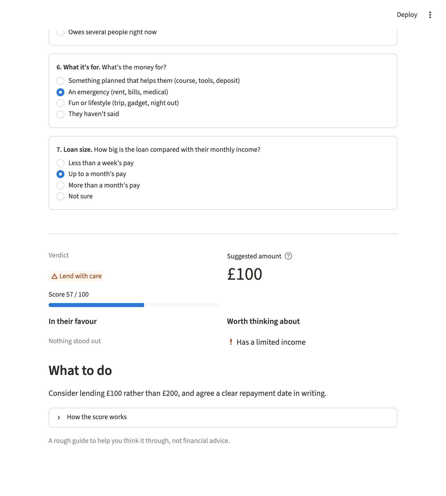

# Should You Lend a Friend?

[](https://github.com/adityaarakeri-max/should-you-lend-a-friend/actions/workflows/ci.yml)


Should you lend money to a friend? Banks decide with bank statements and
credit files, but you can't ask a friend for those. You do know other
things about them: whether they keep promises, how they handle money,
whether they've paid people back before. This app turns seven quick
answers into a verdict, a suggested safe amount and a practical next step.



## How it works

You enter how much they want to borrow and how much you could afford to
lose, then answer seven multiple-choice questions:

| Question | Max points | Why it's there |
|---|---|---|
| Repayment history | 25 | Past repayment is the best guide to future repayment |
| Reliability (on time, keeps promises) | 15 | People who keep small promises tend to keep big ones |
| Money habits | 15 | Budgeting and saving versus running out before payday |
| Income | 15 | Whether they can realistically pay it back |
| Other borrowing | 10 | Someone who owes several people is already stretched |
| What it's for | 10 | A planned purpose versus an unexplained request |
| Loan size vs. their income | 10 | The same idea as loan-to-income in a bank scorecard |

The points add up to 100:

- **70+: Lend.** Agree a repayment date in writing.
- **45–69: Lend with care.** The suggested amount is halved.
- **Below 45: Think twice.** Around a quarter, or help another way.

One rule overrides the score: **if they still owe you money from before,
the verdict is Think twice and the suggested amount is £0** until that's
settled. Whatever the verdict, the suggested amount never goes above what
you said you could afford to lose.

Each answer that earns 80% or more of its question's points is listed as
a strength; 40% or less is listed as something worth thinking about.

## Where AI fits

The rules decide the verdict and the amount. If an Anthropic API key is
set, a button asks Claude to rewrite the advice in a warmer, more specific
way. The prompt keeps it inside the result: it can't suggest more than the
safe amount, it talks about the situation rather than the friend's
character, and it never mentions personal characteristics. Without a key,
or if the call fails, the app uses its built-in advice, so it always works.
Claude calls are capped at 10 per visitor and 200 per day.

## What's deliberately left out

- **Nothing is stored.** Answers live only in the browser session.
- **No protected characteristics.** Age, gender, nationality and similar
  details aren't asked for and don't affect anything.
- **No grades or education.** They say little about whether someone repays
  a loan, so they aren't in the score.

## Run it locally

```bash
git clone https://github.com/adityaarakeri-max/should-you-lend-a-friend.git
cd should-you-lend-a-friend
python3 -m venv .venv && source .venv/bin/activate
pip install -e ".[app,dev]"
cp .env.example .env     # optional: add ANTHROPIC_API_KEY for Claude advice
streamlit run streamlit_app.py
```

Tests and lint, the same checks CI runs on Python 3.11, 3.13 and 3.14:

```bash
pytest
ruff check . && ruff format --check .
```

The 42 tests cover every verdict boundary, the knock-out rule, the
safe-amount rounding and cap, input validation, every advice template,
the Claude error fallbacks (against a fake client, so tests never call
the paid API) and the app itself, driven headlessly with Streamlit's
`AppTest`.

## Project layout

```
lend_check/
  assessment.py   questions, points, verdict and safe amount
  advice.py       built-in advice and the optional Claude rewrite
streamlit_app.py  the web app
tests/            pytest suite, including headless app tests
```

## Related project

[AI Risk-Scoring Simulator](https://github.com/adityaarakeri-max/ai-risk-scoring-simulator)
applies the same idea at a lender's scale: a rules-based credit scorecard
with reason codes, validated against outcomes, with AI only explaining.

## Licence

MIT. See [LICENSE](LICENSE).

*A rough guide to help you think a decision through, not financial advice.*
